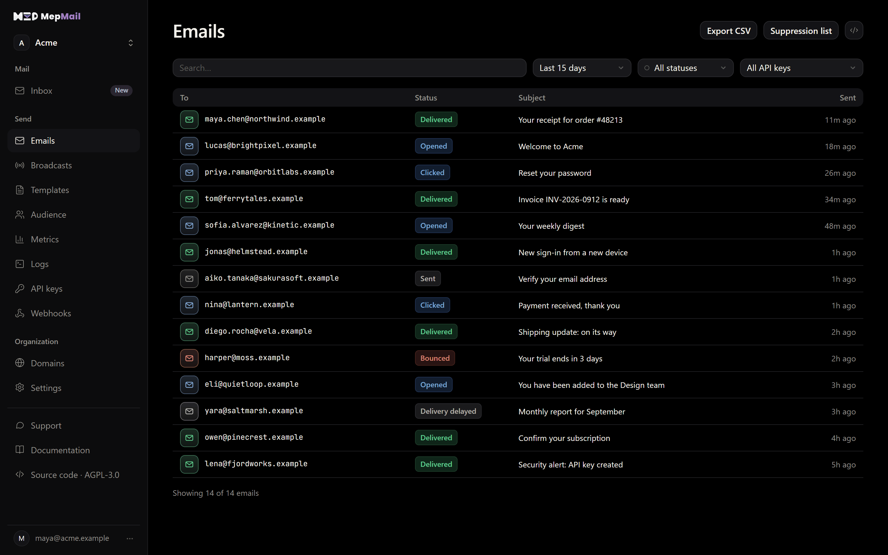
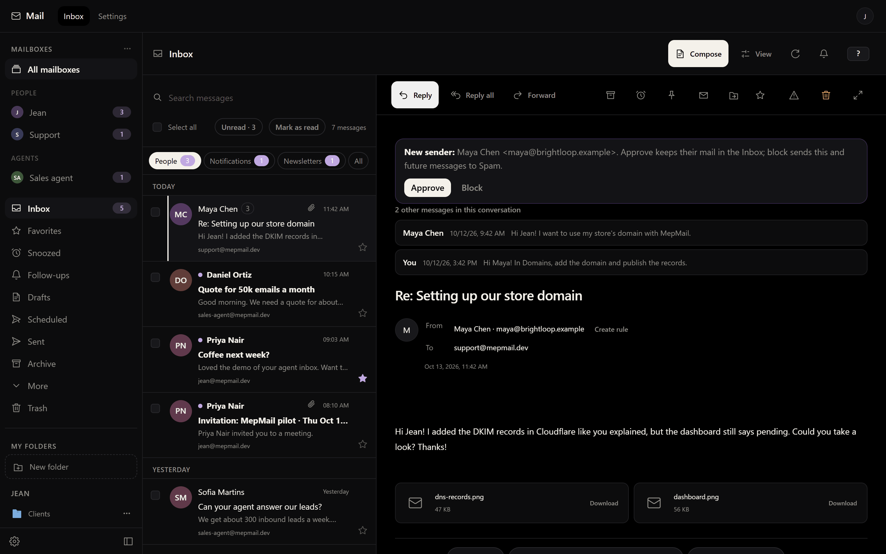

<p align="center">
  <a href="https://mepmail.dev"></a>
</p>

<h3 align="center">The open-source email platform for products, teams and AI agents</h3>

<p align="center">
  Transactional email API (Resend-compatible) · SMTP relay · Broadcasts and newsletters ·<br>
  Business email on your own domain · MCP server for AI agents
</p>

<p align="center">
  <a href="LICENSE"></a>
  <a href="https://www.npmjs.com/package/@mepmail/mcp"></a>
  <a href="https://www.npmjs.com/package/@mepmail/cli"></a>
  <a href="https://docs.mepmail.dev"></a>
  <a href="https://apps.microsoft.com/detail/9nhpx6qrf0pb"></a>
</p>

<p align="center">
  <a href="https://mepmail.dev/signup"><b>Start free on MepMail Cloud</b></a> ·
  <a href="https://mepmail.dev/pricing">Pricing</a> ·
  <a href="https://docs.mepmail.dev">Docs</a> ·
  <a href="#self-hosting">Self-host</a> ·
  <a href="README.pt-BR.md">Português</a>
</p>

<p align="center">
  
</p>

## What is MepMail?

MepMail puts the two kinds of email a company needs in one place:

- **Send**: an email API and SMTP relay for transactional email (sign-ups, receipts,
  password resets, notifications) and marketing broadcasts. It speaks the Resend
  wire format, so the Resend SDK you already use works by changing the base URL.
  Delivery runs on Amazon SES.
- **Correio (Mail)**: business email on your own domain. Mailboxes for people and
  AI agents, a fast webmail, and desktop apps for Windows and Linux.

It is an open-source alternative to Resend, SendGrid, Mailgun and Postmark for
sending, and to the Google Workspace or Microsoft 365 inbox for your domain. The
whole stack is in this repository under AGPL-3.0.

## Cloud or self-hosted

Run it yourself, or let us run it for you. It is the same product, with the same
dashboard, API and SDKs.

| | **[MepMail Cloud](https://mepmail.dev)** | **Self-hosted** |
| --- | --- | --- |
| Setup | Sign up and send your first email in minutes | Docker Compose, your own server and AWS account |
| Amazon SES | Ours: production access, quotas and regions are handled | Yours: leave the SES sandbox and manage quotas |
| Deliverability | DKIM, SPF, DMARC, bounces, complaints and reputation monitored for you | You wire the SNS events and watch the rates |
| Business mailboxes (Correio) | Solo, Duo or Equipe plans | Not covered by the self-hosting guide yet |
| Desktop apps, MCP, updates, backups | Managed | You run upgrades and backups |
| Support | People who build the product, in English and Portuguese | GitHub issues |
| Price | **Free plan: 100 emails a day, no credit card.** Paid plans by card, or Pix in Brazil | Free software; you pay AWS |

**Don't want to run email infrastructure?** [Create a free account](https://mepmail.dev/signup)
and you are sending in a few minutes. Correio plans start at US$ 2.90 a month
(R$ 14,90 in Brazil), with 7 days free on a card. See [pricing](https://mepmail.dev/pricing).

## Features

### Send: email API, SMTP and broadcasts

| Feature | Notes |
| --- | --- |
| Emails API (Resend-compatible) | Send, batch, get and cancel with Resend's request and response shapes. |
| Idempotency | An `Idempotency-Key` header de-duplicates retried sends. |
| SMTP relay | `smtp.mepmail.dev:2587` (STARTTLS), authenticated with an API key. |
| Domains and BYODKIM | Guided DNS verification with live checks; bring your own DKIM key or let SES manage it. |
| Webhooks (Standard Webhooks) | Signed `webhook-*` and `svix-*` headers, per-endpoint events, a delivery log, bring-your-own `whsec_` secret. |
| Contacts and audience | Segments, topics, CSV import and `POST /contacts/batch`. |
| Broadcasts | Compose, schedule and send to every contact, a segment or a topic. |
| Templates | Reusable templates with merge fields and a `/templates` API. |
| One-click unsubscribe | RFC 8058 `List-Unsubscribe` headers plus a hosted unsubscribe page. |
| Suppression list | Hard bounces and complaints suppressed automatically, managed per address or in bulk. |
| Metrics and logs | Daily sends with bounce and complaint rates; every API request logged with secrets redacted. |
| Migrate from Resend | `npx @mepmail/cli migrate --from resend` copies contacts, segments, topics, templates, webhooks, domains and suppressions. Read-only against Resend. |

### Correio: business email on your domain

<p align="center">
  
</p>

- **Mailboxes for people and agents** on your domain, with aliases and team plans
  (Solo with 1 mailbox, Duo with 3, Equipe with 10).
- **A smart inbox**: People, Notifications and Newsletters in separate tabs, and
  a new-sender check: approve keeps a sender in the inbox, block sends them to Spam.
- **Snooze, pin, follow-up reminders, send later, undo send, quick replies,
  folders and automatic rules.**
- **Live updates**, 25 MiB attachments, sender logos (BIMI and Gravatar) and
  message translation.
- **Import** your existing mail from your old provider over IMAP.
- **Desktop apps**: [Windows on the Microsoft Store](https://apps.microsoft.com/detail/9nhpx6qrf0pb)
  and [Linux](https://mepmail.dev/desktop/correio/linux) (AppImage, .deb and .rpm).

### Built for AI agents

- **Official MCP server**: hosted at `https://api.mepmail.dev/mcp` (OAuth) or local
  with `npx -y @mepmail/mcp`, for Claude, Cursor, Codex and any MCP client. Agents
  use the same sending pipeline, limits and logs as your app.
- **Agent mailboxes**: an agent gets its own address, reads and drafts replies,
  and a person can approve each send before it goes out.
- **n8n**: the [`n8n-nodes-mepmail`](https://www.npmjs.com/package/n8n-nodes-mepmail)
  community node, with a new-mail trigger and mailbox operations.
- **Agent discovery**: `/llms.txt`, `/.well-known/ai-catalog.json` and `/auth.md`
  served by the web app.

## Send your first email

Create an API key in the dashboard (it starts with `ms_`), then:

```sh
curl -X POST https://api.mepmail.dev/emails \
  -H "Authorization: Bearer ms_..." \
  -H "Content-Type: application/json" \
  -d '{
    "from": "Acme <onboarding@acme.dev>",
    "to": ["delivered@example.com"],
    "subject": "Hello from MepMail",
    "html": "<strong>It works!</strong>"
  }'
```

Already on Resend? Keep the SDK and point it at MepMail:

```ts
import { Resend } from "resend";

const resend = new Resend("ms_...", { baseUrl: "https://api.mepmail.dev" });

await resend.emails.send({
  from: "Acme <onboarding@acme.dev>",
  to: "delivered@example.com",
  subject: "Hello from MepMail",
  html: "<strong>It works!</strong>",
});
```

On a self-hosted instance, use your own API origin instead of
`https://api.mepmail.dev`. The [quickstart](https://docs.mepmail.dev/quickstart)
and the [SDK guide](https://docs.mepmail.dev/sdks) cover every language.

## Self-hosting

Requirements: Docker with Compose, and an AWS account with SES access. New SES
accounts start in the sandbox and can only send to verified recipients until
AWS grants production access.

```sh
git clone https://github.com/JE4NVRG/mepmail.git mepmail
cd mepmail
cp .env.example .env
```

Fill the two required secrets in `.env`, `MASTER_ENCRYPTION_KEY` and
`BETTER_AUTH_SECRET` (`openssl rand -base64 32` for each), then:

```sh
docker compose up --build -d
```

The dashboard is at http://localhost:3000 and the API at http://localhost:3001.

The supported installation is this local source build (`Dockerfile` and
`docker-compose.yml` at the root). Images or installers published under other
names are not release channels of this project. The AWS setup wizard
(`pnpm setup:aws`), the SES event pipeline, the SMTP relay, TLS, backups and
upgrades are in the [self-hosting guide](https://docs.mepmail.dev/self-hosting)
and in [SELF_HOSTING.md](SELF_HOSTING.md).

## Tech stack

TypeScript monorepo (pnpm and Turborepo): Next.js and tRPC for the dashboard,
Hono for the public API, a worker for queues and SES events, an SMTP server,
PostgreSQL with Drizzle ORM, Better Auth, and Tauri for the desktop app.

| Path | What it is |
| --- | --- |
| `apps/web` | Dashboard, Correio webmail and public site |
| `apps/api` | Public REST API (Resend-compatible) and hosted MCP |
| `apps/worker` | Sending queue, SES events, webhooks and schedules |
| `apps/smtp` | SMTP relay and mail protocols |
| `apps/desktop` | Correio desktop app (Tauri) |
| `apps/docs` | Documentation site ([docs.mepmail.dev](https://docs.mepmail.dev)) |
| `packages/*` | Database, billing, core logic, CLI and MCP server |

## FAQ

**Is MepMail free?** The software is free and open source (AGPL-3.0). MepMail
Cloud has a free plan with 100 emails a day and no credit card; paid plans add
volume and Correio mailboxes.

**Does it work with the Resend SDK?** Yes. Point the SDK's base URL at MepMail and
use a MepMail API key; request and response shapes stay the same. See the
[migration guide](https://docs.mepmail.dev/migrate-from-resend) for the
differences.

**Which provider delivers the email?** Amazon SES, in your own AWS account when
you self-host, or in ours on MepMail Cloud.

**Can AI agents send and receive email?** Yes: through the MCP server and agent
mailboxes, with optional human approval before each send.

## Links

- Website: [mepmail.dev](https://mepmail.dev)
- Pricing: [mepmail.dev/pricing](https://mepmail.dev/pricing)
- Documentation: [docs.mepmail.dev](https://docs.mepmail.dev)
- API: [api.mepmail.dev](https://api.mepmail.dev)
- Coming from Resend: [mepmail.dev/alternatives/resend](https://mepmail.dev/alternatives/resend)
- Integrations: [mepmail.dev/integrations](https://mepmail.dev/integrations)
- Support: [mepmail.dev/support](https://mepmail.dev/support)
- Changelog: [CHANGELOG.md](CHANGELOG.md)

## License

The code is licensed under [AGPL-3.0](LICENSE). The `@mepmail/mcp` server, the
`@mepmail/cli` and the n8n node ship under MIT.

MepMail is a fork of an AGPL-3.0 project. The fork notice, upstream attribution
and third-party notices are in [NOTICE.md](NOTICE.md). Third-party names,
wordmarks and logos belong to their owners and are not licensed under the AGPL.
