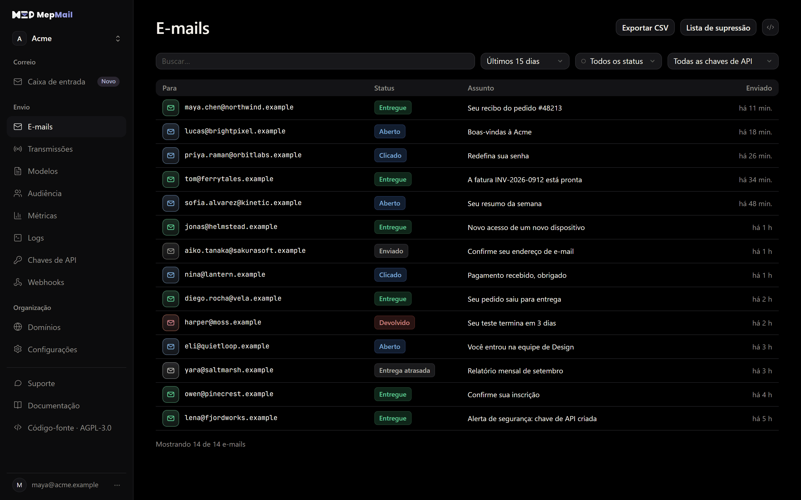
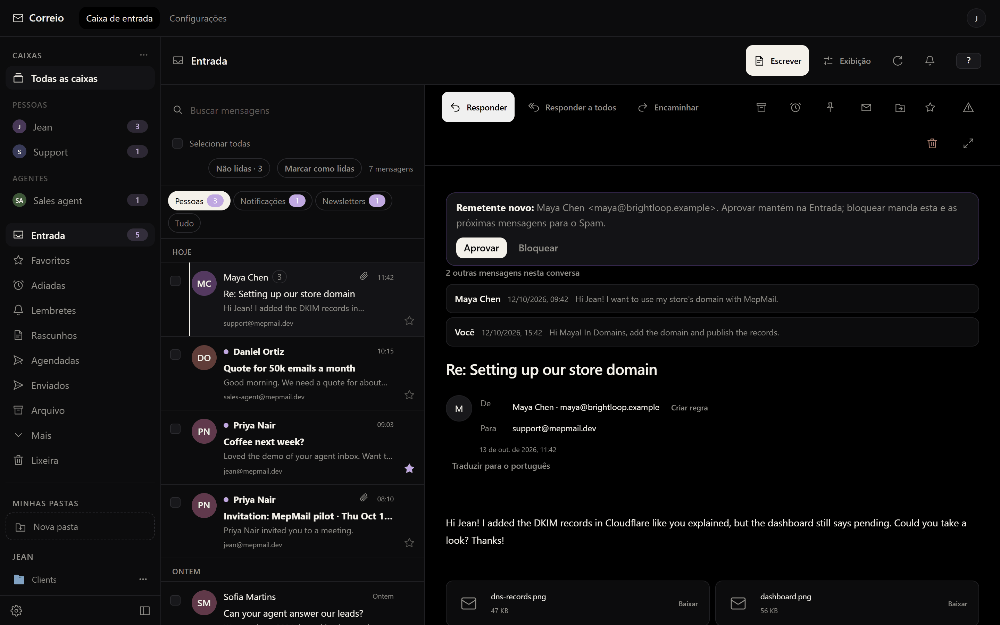

<p align="center">
  <a href="https://mepmail.dev/?lang=pt-BR"></a>
</p>

<h3 align="center">Plataforma de e-mail open source para produtos, equipes e agentes de IA</h3>

<p align="center">
  API de e-mail transacional (compatível com Resend) · Relay SMTP · Campanhas e newsletters ·<br>
  E-mail profissional com domínio próprio · Servidor MCP para agentes de IA
</p>

<p align="center">
  <a href="LICENSE"></a>
  <a href="https://www.npmjs.com/package/@mepmail/mcp"></a>
  <a href="https://www.npmjs.com/package/@mepmail/cli"></a>
  <a href="https://docs.mepmail.dev/pt-BR"></a>
  <a href="https://apps.microsoft.com/detail/9nhpx6qrf0pb"></a>
</p>

<p align="center">
  <a href="https://mepmail.dev/signup?lang=pt-BR"><b>Comece grátis no MepMail Cloud</b></a> ·
  <a href="https://mepmail.dev/pricing?lang=pt-BR">Preços em reais</a> ·
  <a href="https://docs.mepmail.dev/pt-BR">Documentação</a> ·
  <a href="#hospedar-por-conta-própria">Hospedar por conta própria</a> ·
  <a href="README.md">English</a>
</p>

<p align="center">
  
</p>

## O que é o MepMail?

O MepMail junta num só lugar os dois tipos de e-mail de que uma empresa precisa:

- **Envio**: API de e-mail e relay SMTP para e-mail transacional (cadastro,
  recibos, redefinição de senha, notificações) e campanhas de e-mail marketing.
  Usa o mesmo formato da API do Resend: o SDK do Resend que você já usa funciona
  trocando só a URL base. A entrega roda na Amazon SES.
- **Correio**: e-mail profissional com o seu domínio. Caixas para pessoas e para
  agentes de IA, um webmail rápido e apps para Windows e Linux.

É uma alternativa open source ao Resend, SendGrid, Mailgun e Postmark para envio,
e ao e-mail do Google Workspace ou do Microsoft 365 para as caixas do seu domínio.
Todo o código está neste repositório, sob a licença AGPL-3.0.

## Na nuvem ou no seu servidor

Você pode rodar o MepMail por conta própria ou deixar que a gente rode para você.
É o mesmo produto, com o mesmo painel, a mesma API e os mesmos SDKs.

| | **[MepMail Cloud](https://mepmail.dev/?lang=pt-BR)** | **No seu servidor** |
| --- | --- | --- |
| Instalação | Crie a conta e envie o primeiro e-mail em minutos | Docker Compose, servidor e conta AWS próprios |
| Amazon SES | A nossa: acesso de produção, cotas e regiões já resolvidos | A sua: sair do sandbox da SES e cuidar das cotas |
| Entregabilidade | DKIM, SPF, DMARC, devoluções, reclamações e reputação monitorados por nós | Você liga os eventos do SNS e acompanha as taxas |
| Caixas de e-mail (Correio) | Planos Solo, Duo ou Equipe | O guia de hospedagem própria ainda não cobre |
| Apps, MCP, atualizações e backups | Por nossa conta | Você faz as atualizações e os backups |
| Suporte | Com quem constrói o produto, em português e inglês | Issues no GitHub |
| Preço | **Plano grátis: 100 e-mails por dia, sem cartão.** Planos pagos em reais, no cartão ou no Pix | Software livre; você paga a AWS |

**Não quer montar e manter servidor de e-mail?** [Crie sua conta grátis](https://mepmail.dev/signup?lang=pt-BR)
e comece a enviar em poucos minutos. O Correio sai a partir de R$ 14,90 por mês,
no cartão (com 7 dias grátis) ou no Pix. Veja os [preços](https://mepmail.dev/pricing?lang=pt-BR).

## Recursos

### Envio: API de e-mail, SMTP e campanhas

| Recurso | Detalhes |
| --- | --- |
| API de e-mails (compatível com Resend) | Enviar, enviar em lote, consultar e cancelar, com os mesmos formatos de requisição e resposta do Resend. |
| Idempotência | O cabeçalho `Idempotency-Key` evita envio duplicado em novas tentativas. |
| Relay SMTP | `smtp.mepmail.dev:2587` (STARTTLS), com autenticação por chave de API. |
| Domínios e BYODKIM | Verificação de DNS guiada, com checagem ao vivo; use sua própria chave DKIM ou deixe a SES gerenciar. |
| Webhooks (Standard Webhooks) | Cabeçalhos assinados `webhook-*` e `svix-*`, eventos por endpoint, histórico de entregas e segredo `whsec_` próprio. |
| Contatos e audiência | Segmentos, tópicos, importação de CSV e `POST /contacts/batch`. |
| Campanhas | Escreva, agende e envie para todos os contatos, um segmento ou um tópico. |
| Modelos | Modelos reutilizáveis com campos de mesclagem e a API `/templates`. |
| Descadastro em um clique | Cabeçalhos `List-Unsubscribe` (RFC 8058) e página de descadastro hospedada. |
| Lista de supressão | Devoluções permanentes e reclamações suprimidas automaticamente, por endereço ou em lote. |
| Métricas e logs | Envios por dia com taxas de devolução e reclamação; toda requisição da API registrada, com segredos ocultos. |
| Migração do Resend | `npx @mepmail/cli migrate --from resend` copia contatos, segmentos, tópicos, modelos, webhooks, domínios e supressões. Só leitura no Resend. |

### Correio: e-mail profissional com o seu domínio

<p align="center">
  
</p>

- **Caixas para pessoas e agentes** no seu domínio, com aliases e planos por
  equipe (Solo com 1 caixa, Duo com 3, Equipe com 10).
- **Entrada inteligente**: Pessoas, Notificações e Newsletters em abas separadas,
  e aprovação de remetente novo: aprovar mantém na Entrada, bloquear manda para o Spam.
- **Adiar, fixar, lembretes de resposta, envio agendado, desfazer envio,
  respostas rápidas, pastas e regras automáticas.**
- **Atualização ao vivo**, anexos de até 25 MiB, logo do remetente (BIMI e
  Gravatar) e tradução de mensagens.
- **Importação** do seu e-mail antigo por IMAP.
- **Apps**: [Windows na Microsoft Store](https://apps.microsoft.com/detail/9nhpx6qrf0pb)
  e [Linux](https://mepmail.dev/desktop/correio/linux) (AppImage, .deb e .rpm).

### Feito para agentes de IA

- **Servidor MCP oficial**: hospedado em `https://api.mepmail.dev/mcp` (OAuth) ou
  local com `npx -y @mepmail/mcp`, para Claude, Cursor, Codex e qualquer cliente
  MCP. Os agentes usam o mesmo fluxo de envio, os mesmos limites e os mesmos logs
  do seu app.
- **Caixas para agentes**: o agente ganha um endereço próprio, lê e rascunha
  respostas, e uma pessoa pode aprovar cada envio antes de sair.
- **n8n**: o nó da comunidade [`n8n-nodes-mepmail`](https://www.npmjs.com/package/n8n-nodes-mepmail),
  com gatilho de e-mail novo e operações de caixa.
- **Descoberta por agentes**: `/llms.txt`, `/.well-known/ai-catalog.json` e
  `/auth.md` servidos pelo app web.

## Envie seu primeiro e-mail

Crie uma chave de API no painel (ela começa com `ms_`) e rode:

```sh
curl -X POST https://api.mepmail.dev/emails \
  -H "Authorization: Bearer ms_..." \
  -H "Content-Type: application/json" \
  -d '{
    "from": "Acme <onboarding@acme.com.br>",
    "to": ["delivered@example.com"],
    "subject": "Olá do MepMail",
    "html": "<strong>Funcionou!</strong>"
  }'
```

Já usa o Resend? Mantenha o SDK e aponte para o MepMail:

```ts
import { Resend } from "resend";

const resend = new Resend("ms_...", { baseUrl: "https://api.mepmail.dev" });

await resend.emails.send({
  from: "Acme <onboarding@acme.com.br>",
  to: "delivered@example.com",
  subject: "Olá do MepMail",
  html: "<strong>Funcionou!</strong>",
});
```

Numa instância própria, use a URL da sua API no lugar de `https://api.mepmail.dev`.
O [início rápido](https://docs.mepmail.dev/pt-BR/quickstart) e o
[guia de SDKs](https://docs.mepmail.dev/pt-BR/sdks) cobrem todas as linguagens.

## Hospedar por conta própria

Você precisa de Docker com Compose e de uma conta AWS com acesso à SES. Contas
novas da SES começam no sandbox e só enviam para destinatários verificados até a
AWS liberar o acesso de produção.

```sh
git clone https://github.com/JE4NVRG/mepmail.git mepmail
cd mepmail
cp .env.example .env
```

Preencha os dois segredos obrigatórios no `.env`, `MASTER_ENCRYPTION_KEY` e
`BETTER_AUTH_SECRET` (`openssl rand -base64 32` para cada um), e suba:

```sh
docker compose up --build -d
```

O painel fica em http://localhost:3000 e a API em http://localhost:3001.

A instalação suportada é este build local a partir do código (`Dockerfile` e
`docker-compose.yml` na raiz). Imagens ou instaladores publicados com outros
nomes não são canais oficiais deste projeto. O assistente de configuração da AWS
(`pnpm setup:aws`), os eventos da SES, o relay SMTP, TLS, backups e atualizações
estão no [guia de hospedagem própria](https://docs.mepmail.dev/pt-BR/self-hosting)
e no [SELF_HOSTING.md](SELF_HOSTING.md).

## Tecnologias

Monorepo em TypeScript (pnpm e Turborepo): Next.js e tRPC no painel, Hono na API
pública, um worker para filas e eventos da SES, um servidor SMTP, PostgreSQL com
Drizzle ORM, Better Auth e Tauri no app para computador.

| Pasta | O que é |
| --- | --- |
| `apps/web` | Painel, webmail do Correio e site público |
| `apps/api` | API REST pública (compatível com Resend) e MCP hospedado |
| `apps/worker` | Fila de envio, eventos da SES, webhooks e agendamentos |
| `apps/smtp` | Relay SMTP e protocolos de e-mail |
| `apps/desktop` | App do Correio para computador (Tauri) |
| `apps/docs` | Site da documentação ([docs.mepmail.dev](https://docs.mepmail.dev/pt-BR)) |
| `packages/*` | Banco de dados, cobrança, regras centrais, CLI e servidor MCP |

## Perguntas frequentes

**O MepMail é grátis?** O software é livre e open source (AGPL-3.0). O MepMail
Cloud tem plano grátis com 100 e-mails por dia, sem cartão; os planos pagos
aumentam o volume e incluem as caixas do Correio.

**Posso pagar em reais?** Sim. No Brasil, os planos são cobrados em reais, no
cartão ou no Pix.

**Funciona com o SDK do Resend?** Sim. Aponte a URL base do SDK para o MepMail e
use uma chave de API do MepMail; os formatos de requisição e resposta não mudam.
O [guia de migração](https://docs.mepmail.dev/pt-BR/migrate-from-resend) mostra
as diferenças.

**Quem entrega os e-mails?** A Amazon SES: na sua própria conta AWS quando você
hospeda, ou na nossa no MepMail Cloud.

**Agentes de IA podem enviar e receber e-mail?** Sim, pelo servidor MCP e pelas
caixas para agentes, com aprovação humana opcional antes de cada envio.

## Links

- Site: [mepmail.dev](https://mepmail.dev/?lang=pt-BR)
- Preços: [mepmail.dev/pricing](https://mepmail.dev/pricing?lang=pt-BR)
- Documentação: [docs.mepmail.dev](https://docs.mepmail.dev/pt-BR)
- API: [api.mepmail.dev](https://api.mepmail.dev)
- Vindo do Resend: [mepmail.dev/alternatives/resend](https://mepmail.dev/alternatives/resend?lang=pt-BR)
- Integrações: [mepmail.dev/integrations](https://mepmail.dev/integrations?lang=pt-BR)
- Suporte: [mepmail.dev/support](https://mepmail.dev/support?lang=pt-BR)
- Novidades: [CHANGELOG.md](CHANGELOG.md)

## Licença

O código está sob a licença [AGPL-3.0](LICENSE). O servidor `@mepmail/mcp`, a
`@mepmail/cli` e o nó do n8n são distribuídos sob MIT.

O MepMail é um fork de um projeto AGPL-3.0. O aviso de fork, a atribuição ao
projeto de origem e os avisos de terceiros estão no [NOTICE.md](NOTICE.md). Nomes,
marcas e logos de terceiros pertencem aos seus donos e não estão licenciados pela AGPL.
